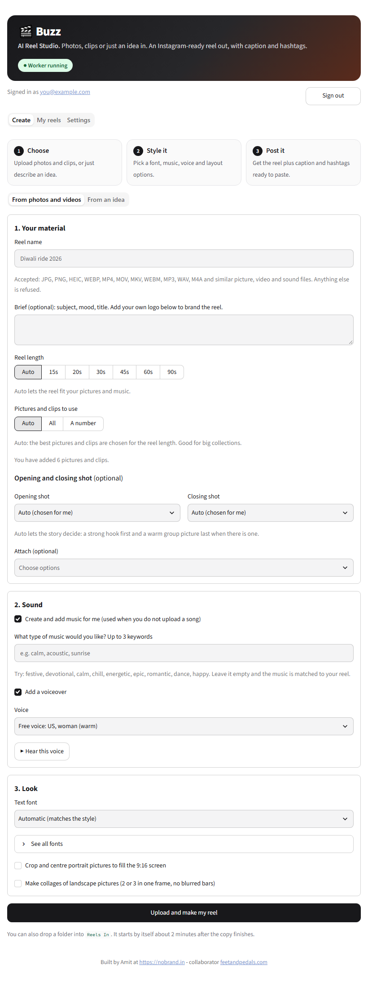
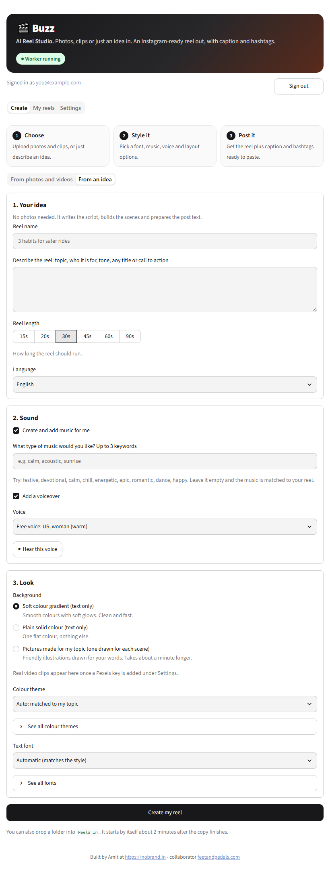
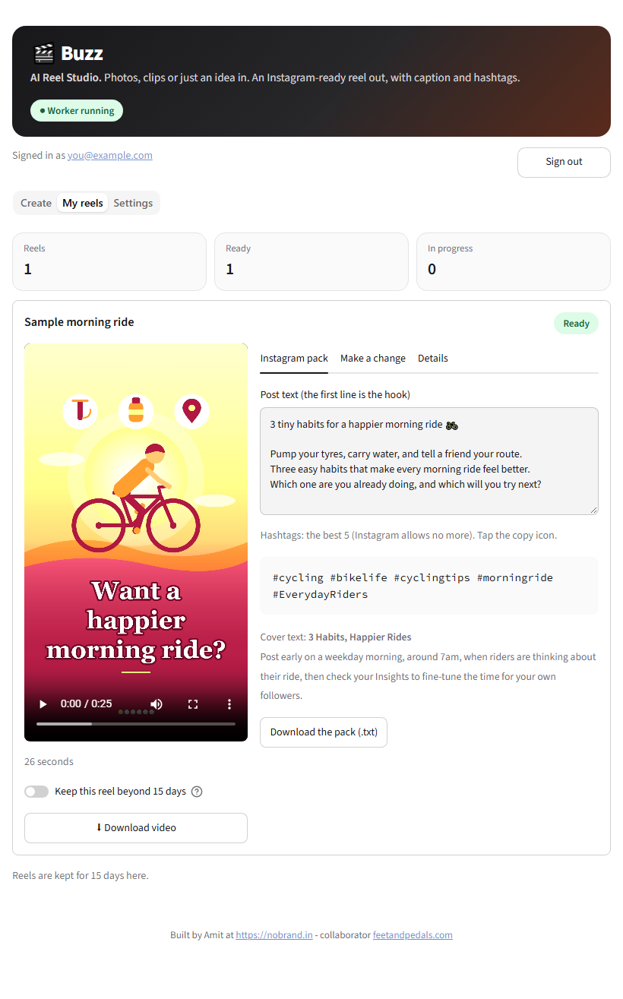
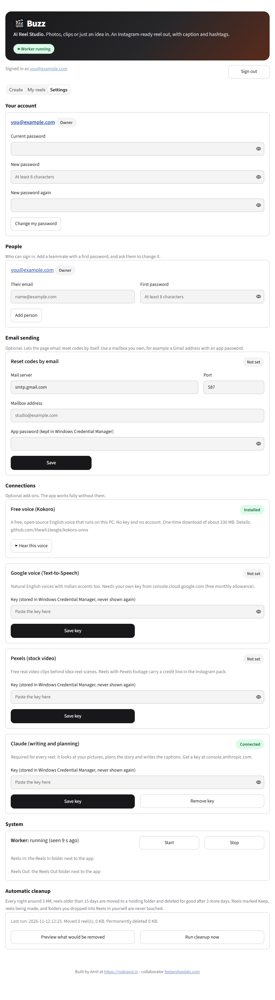

# Buzz

**AI Reel Studio: reels from photos, videos or just an idea**

Buzz turns a stack of photos and videos, or just a written idea, into a ready-to-post 9:16 Instagram reel with music, text, a caption and five hashtags. It runs on a machine you control and works on its own in the background.

## Screenshots









## What it does

- **Runs anywhere.** Windows PC, Linux PC or a Linux server, with the same features. Several people can use one server.
- **Your reels, your key.** Everyone sees only their own reels and can use their own Claude key. The owner sets simple reels-per-day and reels-per-week limits for everyone or for each person, and has an emergency pause switch.
- **Two ways to start.** Upload photos and videos (with your own song, music made for you, or silent), or type an idea and get a finished reel from the words alone.
- **Smart editing.** The AI studies your pictures and clips, plans a story, cuts on the beat, keeps text clear of faces, and lets you choose the opening and closing shot.
- **Instagram pack.** Hook, caption, 5 hashtags, cover text, best time to post and alt text for every reel.
- **Idea reels.** Ten colour themes, with soft gradient, plain colour, drawn pictures or stock video behind the words.
- **Voiceover.** A free voice that runs on your PC (Kokoro), or Google Cloud Text-to-Speech with your own key. Music dips under the voice.
- **Your control.** Reel length from 15 to 90 seconds, how many pictures to use (Auto, All or a number), change notes in plain words, optional logo.
- **Looks after itself.** Live progress, a background worker that restarts itself, accounts with sign-in and remember-me, safe uploads, and a nightly clean-up of old reels.

## What you need

- Windows 10 or 11 with a normal user account (no administrator needed), about 4 GB of free disk, and internet access.
- A Claude API key from console.anthropic.com (required). Buzz is powered by Claude.
- Optional: a Google Cloud Text-to-Speech key (voiceover with Indian, UK and US voices), a Pexels key (stock video for idea reels), a mailbox for emailing password-reset codes.

## How to start

1. Download the latest zip from the **Releases** page and unzip it anywhere (for example Downloads).
2. Double-click **Install Buzz.bat**. It asks where to install (default: Documents\Buzz; press Enter to accept), copies Buzz there, installs Python 3.12 and FFmpeg if they are missing, builds the environment, adds the face finder,
   and sets up two background tasks that start at sign-in.
3. The page opens at http://127.0.0.1:8501. The first screen creates the **owner account** (email and password).
   Then open **Settings** and paste your Claude key in the Claude card (it is kept in Windows Credential Manager, never in a file).
4. Open **Create**, add pictures and clips (or type an idea), press the button, and watch **My reels**.

You can also drop a folder of media into `Reels In` (optionally one song and a `brief.txt`). It starts by itself about two minutes after the copy finishes.

Start and stop: `Start Buzz.bat` and `Stop Buzz.bat`. Finished files are in `Reels Out`.
To remove Buzz, double-click `Uninstall Buzz.bat`. It removes the background tasks and the Python environment, and asks before touching your saved keys or your reels.

## Windows 11 Smart App Control

Windows 11 [Smart App Control](https://support.microsoft.com/en-us/windows/security/threat-malware-protection/smart-app-control-frequently-asked-questions) runs an app only if Microsoft's cloud service judges it safe or the app carries a valid signature; Microsoft states there is no way to allow a single app. Buzz is built from open Python libraries whose compiled files are not signed, so on a PC where Smart App Control is **on**, Windows can block some of them and Buzz may not work there. Buzz does not ask you to lower any security setting.

- **Windows 10, and Windows 11 with Smart App Control off:** the installer works as described above.
- **If Windows blocks the installer file:** before extracting, right-click the downloaded zip, choose **Properties**, tick **Unblock** and press OK, then extract and run `Install Buzz.bat`.
- **If Windows blocks Python library files ("Part of this app has been blocked"):** install Buzz on another PC where it is not an issue and open it from this one, for example over Tailscale (see *Other optional add-ons* above).

## Voiceover

Buzz offers two voices, and you can pick either on the Create page once it is set up:

- **Free voice (Kokoro).** Open source, runs on your PC, no key and no account. On the Settings tab press *Install the free voice*
  (one-time download of about 330 MB). Project: https://github.com/thewh1teagle/kokoro-onnx
- **Google Cloud Text-to-Speech.** Natural voices including Indian English. Needs your own key
  (https://cloud.google.com/text-to-speech, free monthly allowance). Paste it on the Settings tab.

## Other optional add-ons (Settings tab)

- **Pexels key** (https://www.pexels.com/api/): real video clips behind idea-reel scenes. A credit line is added to the post text.
- **A mailbox you own** (for example Gmail with an app password): emails password-reset codes. Without it, the owner makes the code in Settings.
- **Remote access** from your own phone or laptop: install Tailscale and run `tailscale serve --bg 8501`. Do not use Funnel; it would make the page public.

## Linux and servers

```
./install_linux.sh            # Python 3.12, FFmpeg, environment, face detector; no root needed
./deploy/install-services.sh  # worker and web page as systemd user services with CPU and memory caps
```

Then put nginx in front (a ready file is in `deploy/`), open the site, create the owner account and add your Claude key in Settings. Keys are kept encrypted outside the project folder. The full guide, with sizing, secrets, updates and troubleshooting, is `docs/SERVER.md`.

## People, keys and limits

Several people can sign in. Everyone sees only their own reels (the owner sees all) and can add their own Claude key. The owner can allow the shared key per person, set monthly token and daily reel limits and a studio budget, and pause all AI use with one switch.

## Privacy and where things are kept

Buzz runs on a machine you control. Nothing is uploaded except to the services you choose to add (Claude for planning and writing, and optionally Google voice and Pexels).

- Keys live in Windows Credential Manager (service `ai-reel-studio`): `anthropic`, `google_tts`, `pexels`, `smtp`.
- Accounts and sessions are kept as hashes in `Work\users.json` and `Work\sessions.json`. Per-reel working files are in `Work\jobs\`.
- Reels older than 15 days are cleaned up automatically (a Keep switch protects any reel).

## Platform

Buzz runs on **Windows 10/11** and on **Linux** (Ubuntu 22.04 and 24.04 tested), on a PC or on a server. See `docs/SERVER.md` for running it on a server for several people.

## Powered by Claude, free to change

Buzz is powered by Claude. The code is open: you are free to change it and plug in the AI of your choice, whichever works for you.

## Updating

Download the new zip and run `Install Buzz.bat`. Choose the same folder as before: it replaces the program files, adds anything missing, and leaves `Work\`, `Reels In` and `Reels Out` untouched.

## What is in the box

- `src\` the application (30 Python files, about 5,083 lines).
- `CHANGELOG.md` and `Buzz_Changelog_Report.pdf` the history.
- `requirements.txt` exact versions used and tested; `requirements-cv4.txt` the second OpenCV for faces.

## Licence

MIT. Copyright (c) 2026 nobrand.in. See `LICENSE`.

---
Built by Amit at https://nobrand.in - collaborator feetandpedals.com
